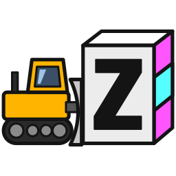

# doszer



Builds `.dosz` archives for [DOSBox Pure](https://github.com/libretro/dosbox-pure)
from `DOSZ.TOML` manifests, so games run without per-game frontend
configuration.

`doszer` is the reference implementation of the
[DOSZ Manifest Specification](spec/MANIFEST.md).

Conformance level: Recipe.

## Status

Early development. Every command is implemented: `init`, `build`
(including `[[extract]]`, media identification (§7) and disc image
conversion (§6.4)), `install`, `run`, `repack`, `verify`, `prepare` and `version`
(doszer's version and the programs it embeds, with their sources).

## Requirements

- Go 1.24 or later, to build
- `ffmpeg` with `libvorbis`, for Ogg Vorbis audio tracks (not needed with
  `audio = "wav"`)
- For `install` and `run`: nothing on Windows; SDL2 (`libSDL2-2.0.so.0`,
  installed on most desktops and SteamOS) on Linux. doszer carries its own
  copy of the DOSBox Pure core (built by `make core`) and runs it in its
  own window. Releases are for Linux (amd64, arm64) and Windows (amd64);
  there is no macOS build, since the core needs Apple's SDK to build.
- To build the embedded core: [zig](https://ziglang.org/) for the Linux
  ones (`make core`), and MinGW-w64 for the Windows one (`make core-all`,
  which `make release` runs)

## Building

```bash
make build   # → build/doszer
make test
make help    # every target
```

## Commands

```
doszer dump    DIR [--drive DRIVE] [--dat FILE]
doszer redump  [SHA1|FILE...] [--update] [--dat FILE]
doszer init    SOURCE [--os PATH | --shell PATH | --exec PATH] [--name NAME] [--no-media] [--system-dir DIR] [-f]
doszer build   SOURCE [OUTPUT.dosz] [--name NAME] [-n] [--strict] [--ogg-quality N]
doszer install SOURCE [--dir PATH] [--from FILE [--content FILE] [--template FILE]] [-f] [-n] [--keep]
               [--os PATH] [--drive c|d] [--system-dir DIR] [--save-dir DIR]
doszer run     FILE.dosz [--option KEY=VALUE...] [--system-dir DIR] [--save-dir DIR]
doszer FILE.dosz
doszer repack  INPUT.dosz [OUTPUT.dosz] [--manifest FILE] [-n] [--strict] [--ogg-quality N]
doszer set     FILE.dosz... [--parent [OLD:]NEW | --no-parent] [--os [OLD:]NEW] [--shell [OLD:]NEW] [-n]
doszer verify  FILE.dosz... | --all [DIR...]
doszer info    FILE.dosz...
doszer prepare shell SHELL OUTPUT [--add DIR...] [-n] [-f]
doszer prepare os    IMAGE OUTPUT [--add DIR...] [-n] [-f]
doszer env     [--system-dir DIR] [--save-dir DIR]
doszer version
```

Options are GNU-style: `-n`/`--dry-run`, `-f`/`--force` and `-h`/`--help`
have short forms (combinable, e.g. `-nf`); a long option's value may follow
it or be attached with `=` (`--name=NAME`); options may come before or after
arguments, and `--` ends them.

On a terminal, each command shows the step it's on with a spinner (and a
count where there is one, e.g. files written), then each finished step
with `✓`, or `✗` for the one that failed. Piped or redirected, only
results, warnings and errors are printed.

Every command takes `--format FMT`, named as in the sibling `romctl`:

| `FMT` | Output |
|---|---|
| `fancy` | Text, with the spinner and finished steps. Default on a terminal. |
| `plain` | The same text without them. Default when piped or redirected. |
| `json`, `yaml`, `toml` | `info`, `verify`, `set` and `version` only: the result, and nothing else, on standard output, for scripts. Several archives are a list under `archives`. |
| `csv` | The same as one row per archive (`info`: its single-valued fields) or program. |

Warnings and errors still go to standard error. A failed archive under a
structured format is in the result (`ok = false`, `errors`), and doszer
exits 1.

`env` shows what doszer finds on this machine: its configuration files,
DOSBox Pure's system and save directories and where each came from
(option, setting, `./system`, beside doszer, RetroDECK), the shells and
OS images DOSBox Pure would list (a dynamic VHD flagged: `install`
refuses one), whether `default_shell`, `default_os` and `install_os`
name images present here, the Redump datfiles, and ffmpeg. It describes
only this machine; archives may be played somewhere else.

`verify --all` checks every `.dosz` under the given directories
(default: the current one), e.g. a collection after copying it, and ends
with a count; any failure makes it exit 1.

| Command | Purpose |
|---|---|
| `init` | Write a commented `DOSZ.TOML` into the source. |
| `build` | Build an archive from a source. Writes only the output file. |
| `install` | Run an installer under DOSBox Pure and extract the chosen folder into the source. |
| `repack` | Rebuild an archive from its embedded manifest. |
| `set` | Change archives' parent, OS image or shell in place. |
| `verify` | Check archives against their embedded manifests and the specification. |
| `info` | Show what an archive holds (below). |
| `env` | Show the directories, images and tools doszer finds on this machine. |
| `prepare` | Make a game-ready copy of a Windows 3.x shell or Windows 9x OS image (see "Preparing a shell", "Windows 9x OS image"). |

`info` shows an archive's size and two SHA-256 hashes:

- `SHA-256`: the file itself, as `sha256sum` prints it. Two builds of the
  same source by the same `doszer` are the same file; anything else,
  including an edit to the manifest's `notes`, changes it.
- `Content`: the files the archive gives DOSBox Pure, which is what the
  specification's equivalence compares (§9): every file but `DOSZ.TOML`.
  Editing `notes` or rebuilding with another `doszer` version (a new
  archive comment) leaves it alone; changing a game file, the boot model
  (`AUTOBOOT.DBP`) or a gamepad mapping changes it. It is the SHA-256 of
  `sha256sum`'s output for those files in byte-wise path order, so it can
  be checked without `doszer`: unzip the archive, then, in it,
  `find . -type f ! -name DOSZ.TOML | LC_ALL=C sort | sed 's|^./||' | xargs -d '\n' sha256sum | sha256sum`.
  An archive with Ogg Vorbis audio has a different content hash when
  built with a different encoder.

Then its name, boot model, parent chain (each parent looked for beside
the archive that names it), the number of programs and the oldest
system that runs them all (from their executable headers: DOS, then the
Windows version a Windows program asks for, e.g. Windows 3.1, Windows 95
or Windows 98), compression (deflated and stored files, sizes, ratio),
each disc image's tracks (data, audio as WAV or Ogg Vorbis) with the
`[[source.media]]` entry declaring it, its track hashes (§7.2) and any
Redump match recorded with them,
gamepad files, the manifest's `notes` and the archive comment. It reads;
`verify` checks.

Without `--exec`, `--shell` or `--os`, `init` picks the boot model from
what the game's programs need, read from their executable headers: the
programs installed in the source, or, if there are none, those on its disc
images. Installers and other helpers that come with a game (setup and
uninstall programs, AutoRun menus, DirectX, Acrobat Reader, registration
cards) don't count when there's anything else. DOS programs need nothing.
A game with both DOS and Windows programs has a DOS version, so it gets
the plain model too; `--shell` or `--os` choose the Windows version.
Windows 3.x programs get a shell, Windows 95 and 98 programs an OS image:
`default_shell` or `default_os` if configured, else the first of these
found in the system directory (any folder, as DOSBox Pure finds them):
`Windows 3.1`, `Windows 3.11`, `Win31`, `Win311`, `WFW311` for a shell;
`Windows 98 (games)`, `Windows 98`, `Win98`, `Windows 98 SE`, `Win98SE`,
then (if the programs don't need Windows 98) `Windows 95 (games)`,
`Windows 95`, `Win95` for an image. It prints one line saying what it
chose and why.

`init` also hashes every disc image (CUE sheet) in the source into
`[[source.media]]` entries (spec §7.2), labelled with the CUE sheet's name;
A CUE sheet with tracks in lossy audio files (Ogg) can't be hashed and is
skipped. `--no-media` skips this. A CUE image whose raw tracks match a
disc in Redump's datfile (the one `doszer redump` uses) also gets the
disc's Redump name (`redump_name`), link (`redump`) and each track's
Redump hash (`redump_sha1`). A converted image can't reproduce Redump's
hashes, so they aren't checked later: they record which Redump dump the
archive's disc is, and `info` shows them.

`build` and `repack` check each `[[source.media]]` entry against the disc
images in the build (spec §7.3). Tracks stored as Ogg can't be checked and
are skipped with a warning; use `audio = "wav"` to keep a disc fully
verifiable. A disc that isn't found fails the build only when `[[extract]]`
reads from it, and is otherwise a warning (a failure under `--strict`).

`build` and `repack` record the game's name, the `doszer` version and
this project's URL in the ZIP comment, which `unzip -z` and most archive
tools show. It is outside the specification's reproducibility rules
(§8.4), and `verify` ignores it. It holds no date, so building the same
source twice with the same `doszer` gives the same file.

Paths match case-insensitively (spec §2), so two source files or archive
entries whose paths differ only in case are one file: `build` and `repack`
keep the one that sorts last (e.g. `readme.txt` over `README.TXT`) and
warn (a failure under `--strict`). A `[[file]]` entry replaces a file at
its path whatever the case.

Every path in a manifest and every entry name in an archive is `/`
separated, with no empty, `.` or `..` component and no `\` (spec §2,
§8.2): `GAME/./X.TXT`, `GAME//X.TXT` or a trailing `/` is rejected, not
cleaned up. `[[extract]] from = "/"` names the disc's root directory.
`build` rejects a source file whose name contains a `\`. `repack` reads
a legacy archive's entry names as paths: `GAME\X.TXT` (written by some
Windows tools), `./GAME/X.TXT` and `/GAME/X.TXT` become `GAME/X.TXT`,
and an entry outside the archive (`../X.TXT`) or two entries naming the
same path are an error.

`set` changes archives' parent, OS image or shell in place, e.g. after
renaming a parent archive or an image in the system directory:

```
doszer set --os 'dosbox_pure/Win98:dosbox_pure/Windows 98' *.dosz
doszer set --parent 'Base Game (v2).dosz' 'Expansion.dosz'
doszer set *.dosz        # show each archive's settings
```

`OLD:NEW` changes only archives where the setting is `OLD` now (exactly,
as DOSBox Pure matches names); a bare `NEW` changes every archive the
setting applies to: `--os` only those booting an OS image, `--shell`
only those booting a shell. Only the embedded manifest and the files that
follow from it (`AUTOBOOT.DBP`, the parent marker) are rewritten; every
other entry is copied through, so it takes seconds whatever the archive's
size, and the result is what `repack` would make from the edited manifest.
Neither `build`, `repack` nor `set` writes an empty root `.parent` file
other than the manifest's parent marker: DOSBox Pure refuses an archive
with two.

The default output is `<name>.dosz` in the current directory. `--name`
overrides the manifest's `name`, which defaults to the source directory name.
An output inside the source (a build run from the source directory) is not
collected into the next build: it is replaced.

`build --dry-run` prints the planned trim, flatten, media conversion and
rewrite operations without writing anything. For every path changed by flattening, it searches
files up to 8 MB for references, suggests `[[layout.rewrite]]` rules, and
reports references in binary files (containing a NUL byte) that cannot be
rewritten. A rewrite rule applies to any file without a NUL byte that its
`files` patterns name, e.g. an INI-style `RESOURCE.CFG` (spec §6.5).

## Dumping and verifying discs

`dump` reads a CD with redumper into `DIR`, as `disc<N>.cue` and its
track files. redumper's work files (an image of the raw disc and its
state) are kept beside `DIR`, in `.<DIR>.doszer-dump`, until the dump is
done, so a failed or interrupted dump resumes, re-reading only what's
missing; its log is kept in `doszer/dumps` in the user cache directory.
A drive that can't read the lead-out can't read the last few samples a
positive read offset shifts into it: the dump is finished with them left
as zeros, as they almost always are on the disc, and reported.

The dump is then checked against Redump's IBM PC datfile, matching every
track's size and SHA-1: `Verified`, or the closest disc and the tracks
that differ, or no match (a bad dump, or a disc not in Redump yet). The
datfile is, in order: `--dat`/`redump_dat` (any Logiqx datfile); a copy
fetched from redump.org at most weekly and cached in the user cache
directory; the snapshot built into doszer (`make dat`). `doszer redump`
shows which is in use, `--update` fetches the current one, and given
SHA-1s, track files, or a disc image (a CUE sheet, or a zip of one) it
looks them up.

### From an existing image

`dump --from FILE` takes a disc image you already have instead of a
drive: a CUE sheet with its BIN (or WAV) files in any layout, or a zip
holding them, as Redump-style downloads come. It writes the same
`disc<N>.cue` and track files a dump of the disc would - one raw file per
track, each from its pregap to the next track's, `PREGAP` silence filled
in as zeros - and checks them against Redump the same way. The image
itself is left alone. From there on, `init`, `install` and `build` can't
tell an imported disc from a dumped one: two exact copies of a disc,
however each was made, build byte-identical archives (§8.2 dates a disc
image's files by the disc's own volume creation date, not the dump's).

Rippers other than redumper (ImgBurn, for one) don't correct the drive's
read offset, so every audio sample sits that many samples off and audio
tracks don't match Redump; data tracks are unaffected. `--offset SAMPLES`
corrects it: the drive's read offset, as redumper's log prints it for the
same drive (`read offset: +6`) or AccurateRip's drive list gives it. `doszer
redump --offset SAMPLES IMAGE` checks an image the same way without
importing it.

A worn disc that won't read cleanly in one drive may in another, or with
another program: check each image with `doszer redump` and import the one
that verifies.

## Media conversion

`build` and `repack` convert every disc image in the build (spec §6.4):
data tracks become ISO images, audio tracks stored as raw CD-DA become Ogg
Vorbis or WAV, and the CUE sheet is rewritten to match. Implementation
details:

- Ogg Vorbis is encoded by `ffmpeg`'s `libvorbis` at `ogg_quality`
  (default 6; see Configuration), with `-fflags +bitexact -flags +bitexact`
  so the same `ffmpeg` and `libvorbis` versions produce identical files.
  WAV files are written directly.
- Tracks are encoded in parallel, one per CPU, and written to a temporary
  `.doszer-build-*` directory next to the output archive, removed when the
  build ends. A data track `[[extract]]` reads from is read in place if
  it is already 2048-byte sectors (an ISO, or a `MODE1/2048` BIN), else
  copied to a temporary `.doszer-media-*.iso` file there while it is
  being identified.
- Disc images inside an archive being repacked are streamed, not loaded
  into memory.
- A CUE sheet whose referenced files aren't all in the build, or that uses
  `MOTOROLA` (big-endian) files, is left unconverted with a warning
  (a failure under `--strict`).
- Audio already encoded (any CUE `FILE` type other than `BINARY`) is kept
  as it is, even if `[pack].audio` asks for the other encoding.
- `verify` reports a CUE sheet that §6.4 would still change, and warns
  about a `[[source.media]]` entry the archive's disc images don't match.

## Gamepad mappings

An archive can ship its own controller mapping, so a game is playable on a
gamepad-only device (e.g. a Steam Deck or Steam Machine) with no setup.
Without one, DOSBox Pure uses its built-in mapping for games it
recognizes, else generic keyboard keys. Give one `[[input.pad]]` per
controller port (spec §5.9):

```toml
[[input.pad]]
b            = "space Fire"          # action, then an optional label
a            = "leftctrl+enter Use"  # up to 4 actions pressed together
start        = "esc Menu"
lstick_up    = "up"
lstick_down  = "down"
lstick_left  = "left"
lstick_right = "right"
rstick_left  = "mouse_move_left"     # mouse moves with the stick
rstick_right = "mouse_move_right"
rstick_up    = "mouse_move_up"
rstick_down  = "mouse_move_down"
r2           = "mouse_left_click"
r            = "wheel"               # hold for the action wheel
wheel        = ["f1 Help", "f5 Save", "f9 Load"]
```

Controls use libretro's RetroPad names, which are positions, not the
letters printed on the buttons:

| RetroPad | Steam Deck / Xbox | PlayStation |
|---|---|---|
| `b` (bottom) | A | Cross |
| `a` (right) | B | Circle |
| `y` (left) | X | Square |
| `x` (top) | Y | Triangle |
| `l`, `r` / `l2`, `r2` | LB, RB / LT, RT | L1, R1 / L2, R2 |
| `l3`, `r3` | stick clicks | L3, R3 |
| `select`, `start` | View, Menu | Share, Options |

The Deck's back buttons (L4/R4/L5/R5) aren't RetroPad controls: bind them
to one of the above in Steam Input.

`build` writes the mapping as `PADMAP.DBP`, the file DOSBox Pure's own
Controller Mapper saves, and port 1's mapping again as `input_pad_` lines
in `DOS.YML` (spec §6.8). DOSBox Pure uses `PADMAP.DBP`; `DOS.YML` adds the
labels, shown in the Controller Mapper and the action wheel, and is what
port 1 falls back to if a player resets their mapping. A stick axis is one
binding there, so its two directions show one joined label
(`lstick_up = "up Forward"` and `lstick_down = "down Backward"` both show
"Forward / Backward"). A player's own
changes are saved to their save file, over the archive's. Lines of a
`DOS.YML` already in the source other than `input_pad_`/`input_wheel_` are
kept.

L3 opens DOSBox Pure's menu and on-screen keyboard unless the mapping binds
it (`Input > Use L3 Button to Show Menu`). Bind `menu` to another control
to keep that if L3 is needed for something else. `hold_port2` makes a
control a shift key: while it's held, the pad uses `[[input.pad]]` #2's
mapping, doubling the controls one pad has.

To try a mapping out, open the Controller Mapper from DOSBox Pure's menu
in the game, then copy what works into the manifest. A `PADMAP.DBP` made
with the Controller Mapper can also be shipped as it is: copy it from the
save file (`<save dir>/<content>.pure.zip`) into the source's root. It is
binary, labels are lost, and `[[input.pad]]` replaces it.

In RetroArch, each port's device type (Quick Menu, Controls) must be the
default, "Use Gamepad Mapper" (it may show as `[Pad Mapper] ...`); a preset
there ignores the archive's mapping for that port.

## Boot models

Every archive runs one of three ways (specification §4). Pick by what the
game needs, from its box, manual or installer:

| The game needs | Boot model | Manifest | The game's files are on |
|---|---|---|---|
| DOS | Plain | `exec` = program to start, or nothing (start menu) | C: |
| An environment that runs on DOS, e.g. Windows 3.x | Shell | `shell` = the shell's path | C:, merged with the shell |
| An operating system that boots itself, e.g. Windows 95 or 98 | OS image | `os` = the image's path | D: |

- **Plain**: DOSBox Pure's built-in DOS, nothing else needed. Most DOS
  games.
- **Shell**: a `.dosz` of files laid under C: and run by the built-in DOS,
  e.g. a Windows 3.x installation shared by several games. It starts
  `C:\WINDOWS.BAT`, else `C:\AUTOEXEC.BAT`, else `C:\WINDOWS\WIN.COM`.
- **OS image**: a hard disk image (`.vhd`/`.img`) with an installed
  operating system, which boots itself. Windows 95 and 98 have to be
  images, not shells: they start from their own DOS, which has to boot
  from a disk. So does a game that needs a real MS-DOS rather than
  DOSBox's.

Shells and images aren't part of an archive. Each player provides their
own, in the frontend's system directory; `shell` and `os` give its path
there, without extension, and are the same for every game that uses it.

A CD with both a DOS and a Windows version can use either; the DOS
version needs nothing beyond DOSBox Pure.

## Example

```bash
mkdir "Example Game"
# copy the game's files and disc images into it
doszer init --os path/to/image "Example Game"
# edit Example Game/DOSZ.TOML
doszer build --dry-run "Example Game"
doszer build "Example Game"
```

[examples/](examples/) holds complete manifests for real games:
[Betrayal in Antara](examples/betrayal-in-antara/DOSZ.TOML), a Windows 95
game under an OS image, with trimming, flattening, rewrites, a startup
`WINDOWS.BAT` and its discs identified by track hash; and
[King's Quest VII](examples/kings-quest-vii/DOSZ.TOML), a DOS game
installed from CD under the plain model.

## From a CD to a .dosz

A DOS game that installs from CD, start to finish, under the plain model
(see "Boot models" for the others). This assumes a disc you own.
[examples/kings-quest-vii](examples/kings-quest-vii/DOSZ.TOML) is the
result for one.

`install` needs no setup: it runs DOSBox Pure in a window of its own.

1. **Dump the disc** with the CD in the drive:

   ```bash
   doszer dump "Example Game"
   ```

   This writes `disc1.cue` and its tracks to `Example Game/`; run it again
   with the next disc of a multi-disc game. doszer carries
   [redumper](https://github.com/superg/redumper), which corrects the
   drive's read offset, so the dump matches anyone else's of the same disc,
   and then checks it against [Redump](http://redump.org)'s database:
   `Verified` means every track matches a disc others have dumped and
   cross-checked, so the dump is exact. Under WSL it runs the Windows
   redumper, since WSL can't reach optical drives; `--drive E:` picks a
   drive. An interrupted or failed dump resumes where it stopped when run
   again. A BIN/CUE or ISO from any other ripping tool works too
   (`doszer redump disc.cue` checks it). File names don't matter: `build`
   renames the disc after the game.

2. **Write a manifest:**

   ```bash
   doszer init "Example Game"
   ```

   It identifies the disc by its content, so later builds can check they
   have the right one.

3. **Install the game:**

   ```bash
   doszer install "Example Game"
   ```

   DOSBox Pure starts with the CD mounted as `D:`. Its start menu lists
   every program on the CD: pick the installer (`INSTALL.BAT`,
   `INSTALL.EXE`, `SETUP.EXE`, ...), or go to the command line and type
   `D:` and then `INSTALL`. Install to `C:` and keep the default folder.
   - Sound: DOSBox Pure emulates a Sound Blaster 16 at address 220, IRQ 7,
     DMA 1 (high DMA 5); General MIDI (MPU-401 at 330) only once a MIDI
     soundfont or device is chosen in its settings.
   - If the installer offers to copy game data from the CD to the hard
     disk for speed, choose the least: in the archive, the CD and the hard
     disk are the same file, so a copy only makes it bigger.
   - Errors from commands DOSBox doesn't have (e.g. `Illegal command:
     mode.`) are usually harmless; the installer carries on.
   - Note how the installer says to start the game.

   Start the game once if you like, then close DOSBox Pure.
   `doszer`
   copies the folder the installer created (e.g. `C:\GAME`) into
   `Example Game/GAME/`.

4. **Check the startup program.** `install` lists the batch files and
   programs the installer wrote, and if exactly one batch file sits at
   the top of the new folder (the one installers write to start the
   game), sets it as `exec` in `Example Game/DOSZ.TOML`:

   ```
   Programs installed:
     C:\GAME\GAME.BAT
     C:\GAME\GAME.EXE
     C:\GAME\SETUP.EXE
   Set boot.exec = 'C:\GAME\GAME.BAT' in DOSZ.TOML
   ```

   Otherwise, set it yourself to what the installer said to run:

   ```toml
   [boot]
   exec = 'C:\GAME\GAME.EXE'
   ```

   Keep the folder where it is: installers write their own path (and the
   CD's drive letter, `D:`) into the game's batch and configuration files.

5. **Build and check:**

   ```bash
   doszer build --dry-run "Example Game"
   doszer build "Example Game"
   doszer verify "Example Game.dosz"
   ```

6. **Play:** put `Example Game.dosz` with your other DOSBox Pure content.
   It starts the game directly.

## Configuration

Every setting can be given as a flag. Precedence, highest first:

1. Command-line flags
2. `<source>/DOSZ.TOML`'s `[x-doszer]` table (per-game settings)
3. `./doszer.toml`
4. `$XDG_CONFIG_HOME/doszer/config.toml` (default `~/.config/doszer/config.toml`)
5. Built-in defaults

`doszer.toml` and the user config file take the settings at top level:

```toml
system_dir  = "/path/to/system"      # DOSBox Pure's system directory (OS images, shells)
save_dir    = "/path/to/saves"       # DOSBox Pure's save directory
ogg_quality = 6

[templates]                          # pristine OS images used by install
"path/to/image" = "/path/to/image.template"

[install_os]                         # image install sessions boot, by boot.os
"path/to/image" = "path/to/install-image"
```

```toml
default_shell = "dosbox_pure/Windows 3.1"       # init's shell for Windows 3.x games
default_os    = "dosbox_pure/Windows 98 (games)" # init's OS image for Windows 9x games
```

A manifest overrides them the same way, under `[x-doszer]` (spec §5.10's
extension-key namespace, so the manifest schema doesn't reject it):

```toml
[x-doszer]
ogg_quality = 10
```

`templates` and `install_os` merge by key across layers; every other setting is replaced
whole by the most specific layer that sets it. `repack` has no source
directory, so it skips the `[x-doszer]` layer.

## Install

`install` runs an installer under DOSBox Pure (see "DOSBox Pure in
doszer") and extracts what it wrote into the source. It packs the source (install media included,
`DOSZ.TOML` and `DOSBOX.BAT` left out) into a temporary archive with a
unique name, so the session's save files are fresh, starts DOSBox Pure on
it, and waits for its window to close. Then it reads the save files:

| Boot model | Session starts | Install to | Changes read from |
|---|---|---|---|
| OS image | the OS image (`boot.os`) | D: | `<name>-<HASH>.sav` over the D: disk DOSBox Pure builds from the archive |
| Shell | the shell (`boot.shell`) | C: | `<name>.pure.zip` |
| Plain | DOSBox Pure's start menu | C: | `<name>.pure.zip` |

An OS image session runs under "Save Difference Per Content", so the OS
image is never modified and C: changes land in `<name>-CDRIVE.sav`;
they're listed, not extracted, since every archive shares C:. (Archives
themselves run under "Discard", specification §12; `install` keeps C:
for its one session so `--drive c` can read it.)

The OS image must be a raw `.img` or a fixed-size VHD, not a dynamic
(growing) VHD: DOSBox Pure's "Save Difference" mode compares written
sectors against the wrong bytes of a dynamic VHD and silently drops some
writes, corrupting the session's C: (and, in a frontend, any game's C:
changes). `install` refuses a dynamic VHD; "Discard", which `run` uses,
is unaffected. To convert one:
`qemu-img convert -O vpc -o subformat=fixed dynamic.vhd fixed.vhd`.

An OS image session boots `--os`, else the image `install_os` maps
`boot.os` to, else `boot.os` itself: an archive's own image may start the
game through a custom shell, while installing wants a plain Windows
desktop. `--drive c` extracts from C: instead of D:, for an installer that
only works in its default folder on C:; the folder is `--dir`, or the one
top-level folder outside `WINDOWS` every change is under. The game's paths
then name C:, which the manifest's `[[layout.rewrite]]` rules can fix
(`build --dry-run` suggests rules for paths that move).

The folder to extract is `--dir`, or the one top-level folder every
change is under, or the root when every change is a file there (`--dir /`
asks for the root). A session that changed nothing extracts nothing:
DOSBox Pure doesn't save a file rewritten with the same content, so
running a setup program and keeping its settings leaves no change. A
game that comes installed doesn't need `install`; `init` and `build` it
as it is. Other changes are listed. A file already in the source
with different content stops the extraction unless `--force` is given.
Paths match the source's case-insensitively, as DOS paths do: a changed
`GAME/SETUP.CFG` replaces the source's `game/setup.cfg`. Save files are removed after a successful extraction unless `--keep` is
given.

For a plain model install, `install` lists the `.BAT`, `.COM` and `.EXE`
files the installer added in the extracted folder or one folder below it,
and if the manifest has no `exec` and exactly one batch file is at the
shallowest level, sets `exec` to it (not under `--dry-run`, which only
reports it). Under the other models the shell or OS image starts the
game (`WINDOWS.BAT`), so there is no `exec` to set.

Installers for Windows 95 and 98 often record settings in the registry,
on C:, which the archive boots as it was, without them. So whenever C:
changes are read from a Windows 9x OS image (an OS image session, or
`--from` a `-CDRIVE.sav` or an image with a template), `install` compares
its registry (`WINDOWS\SYSTEM.DAT`, `WINDOWS\USER.DAT`) before and after,
and writes what the installer added for its program as `INSTALL.REG` in
the extracted folder: keys under `Software`, except the ones Windows
changes on its own (`Microsoft`, `Classes`, `Description`). It prints the
line `WINDOWS.BAT` needs to restore them at each startup:

```bat
REGEDIT /S D:\GAME\INSTALL.REG
```

A game that reads nothing from the registry runs without it.

The extracted folder is on D: in the archive wherever the game was
installed, so with `--drive c`, paths into it in `INSTALL.REG` are moved
from C: to D:.

Installers also put runtime DLLs into Windows' own folders
(`C:\WINDOWS\SYSTEM`), which the archive doesn't carry either. So
`install` reads the import tables of the extracted folder's programs and
copies each DLL the installer added to or changed in `C:\WINDOWS` or
`C:\WINDOWS\SYSTEM` that one of them imports (and the DLLs those import)
beside the program: Windows looks in a program's own folder first. Other
changes to Windows, such as fonts, are listed but not carried over.

`install --from <file>` skips DOSBox Pure and extracts from an existing
save or disk image:

| `--from` | Also needs |
|---|---|
| `<content>-<HASH>.sav` (D:) | `--content`, the archive it was made over; the hash must match |
| `<content>-CDRIVE.sav` (C:) | the image it was made over: `--os`, `install_os` or `boot.os` |
| `.pure.zip` | (`--content` to tell modified files from added ones) |
| `.vhd`, `.img` | `--template` or a configured template to compare against, else `--dir` |

Limitations: a change is detected by size or modification time; the
content must not have a `<content>.pure.zip` of its own layered over it,
or parent archives.

## Run

`doszer run FILE.dosz` plays a built archive, to try it without a
frontend. Its saves are named after the archive in the save directory, so
the next `run` continues from them. An archive that boots an OS image
runs under "Discard" (specification §12): the image is never written to,
C: starts from the image every time, and only the archive's own D:
changes are kept.

`--option KEY=VALUE` sets a DOSBox Pure core option for the session, e.g.
`--option cycles=max` or `--option midi=mt32` (the `dosbox_pure_` prefix
is optional; keys are in DOSBox Pure's `core_options.h`). Specification
§12's options can't be changed.

`doszer FILE.dosz`, with no command, does the same, so doszer can be the
program that opens `.dosz` files (`doszer "%1"` on Windows).

## DOSBox Pure in doszer

`install` and `run` use the DOSBox Pure libretro core doszer embeds,
built from DOSBox Pure 1.0 Preview 8 (`make core`), which doszer's
save-file handling was checked against, in a window of their own. The
core is unpacked to the user cache directory on first use. doszer passes
the core its options directly, so no frontend's configuration is read or
changed.

- OS images and shells come from `system_dir` (`--system-dir`), else a
  `system/` folder in the working directory, else one beside the doszer
  executable (as standalone DOSBox Pure keeps its own), else RetroDECK's
  BIOS folder (`bios_path` in
  `~/.var/app/net.retrodeck.retrodeck/config/retrodeck/retrodeck.json`).
  A manifest's `os = 'dosbox_pure/Win98'` is then
  `system/dosbox_pure/Win98.vhd` (or `.img`).
- `run`'s saves go to `save_dir` (`--save-dir`), else a `saves/` folder
  in the working directory, else one beside the doszer executable, else,
  for an archive in RetroDECK's ROM folders (`roms_path`), RetroDECK's own:
  `<saves_path>/<the archive's folder>`, as RetroArch sorts saves by
  content directory (`roms/dos/Game.dosz` saves in `saves/dos`,
  `roms/windows9x/Game.dosz` in `saves/windows9x`), so `run` and RetroDECK
  continue each other's games. Otherwise, and always for `install`, whose
  session saves are throwaway, `save_dir` or `doszer/saves` in the user
  cache directory.

| Keys | |
|---|---|
| Click | capture the mouse |
| Ctrl+F10 | release the mouse |
| Alt+Enter | toggle fullscreen |
| Alt+F12 (hold) | fast-forward, without sound |
| Ctrl+F5 | screenshot, at the game's resolution, to `Pictures/doszer` in the home directory |

Fast-forward, screenshot and mouse release use DOSBox's own keys. Under
WSLg the desktop pointer stays visible over
the window, as WSLg draws it on the Windows side; use the Windows build
there. It's built
for linux/amd64 and linux/arm64 (glibc 2.28 or later and the system's
SDL2; WSLg under WSL) and windows/amd64 (it carries SDL2).

## Frontend setup

Archives assume these DOSBox Pure core options (see the specification, §12):

| Option | Value |
|---|---|
| `dosbox_pure_bootos_ramdisk` | `true` (Discard) |
| `dosbox_pure_menu_time` | `0` |

OS images and system shells go in a `dosbox_pure/` subdirectory of the
frontend's system directory, e.g. `dosbox_pure/<image>.vhd`, named
however you like: a manifest's `shell` or `os` names the file by its path
there (`dosbox_pure/<image>`), so archives that share one must use the
same name.

### Preparing a shell

`doszer prepare shell` makes a copy of a Windows 3.x shell (a `.dosz`,
`.zip` or directory of its files) that can start a game and close
DOSBox Pure when the game quits:

```bash
doszer prepare shell Win31.dosz "Win31 (games).dosz"
```

The output is a new shell built for running games, not a copy of the
original: files Windows can do without are left out and settings are
changed, and nothing guarantees that anything else in the input is kept.
Keep the original. The changes:

- adds [RunExit](https://github.com/andshrew/RunExit) (embedded,
  MIT license) as `C:\RUNEXIT\RUNEXIT.EXE`, with its licence;
- removes swap files (`386SPART.PAR`, `WIN386.SWP`) and leftover
  temporary files (`~*.TMP`), and the permanent swap file settings in
  `SYSTEM.INI` (Windows would report the missing file at startup and
  wait);
- sets a black desktop in `WIN.INI`: no wallpaper or pattern, background
  `0 0 0`;
- lays each `--add DIR`'s files over the result, replacing files of the
  same name.

Every other file, and its date, is kept. `-n` prints the changes without
writing anything.

A game's `WINDOWS.BAT` (run instead of the shell's own `AUTOEXEC.BAT`,
so it sets `PATH` and `TEMP` itself) then starts Windows with RunExit,
which runs the game and exits Windows when it quits. The shell's startup
then ends, and DOSBox Pure closes (with `dosbox_pure_menu_time` = `0`;
`dosbox_pure_osd.h`, `PUREMENU -FINISH`). Without RunExit, as in an
unprepared shell, it starts the game in a plain Windows session:

```bat
@ECHO OFF
PATH C:\WINDOWS
SET TEMP=C:\WINDOWS\TEMP
IF NOT EXIST C:\RUNEXIT\RUNEXIT.EXE GOTO PLAIN
WIN C:\RUNEXIT\RUNEXIT.EXE /show=3 C:\GAME\GAME.EXE
GOTO END
:PLAIN
WIN C:\GAME\GAME.EXE
:END
```

`/show=3` starts the game maximized; RunExit's README lists its other
options. PRESSKEY (below) is a 32-bit Windows 95 program and doesn't run
under Windows 3.x.

### Windows 9x OS image

`doszer prepare os` makes a copy of a Windows 95/98 image with
specification §12's startup behaviour:

```bash
doszer prepare os "Windows 98.vhd" "Windows 98 (games).vhd"
```

As with a shell, the output is a new image built for running games, not
a copy of the original: keep the original, and install games with it,
since a prepared image has no Explorer desktop for installers. Map the
prepared image to the original in `install_os` (Configuration), and
`install` boots the original for any game whose `boot.os` names the
prepared one. The input is a VHD (fixed or dynamic) or a raw `.img` and is
only read; the output is a fixed VHD (a raw image for raw input) of the
same size, whatever the input's type, and never the input itself. It must
be named `.vhd`, `.img` or `.ima`, the extensions DOSBox Pure lists (it
tells a VHD by its footer, not its name; `prepare shell`'s output, a
shell, must be `.dosz`). Its file
system is rebuilt in the same geometry, every file contiguous: the MBR and
boot sectors are copied unchanged, and every kept file keeps its short and
long name, attributes and dates. The changes:

- `C:\WINDOWS\SYSTEM.INI`, `[boot]`: `shell=Explorer.exe` becomes
  `shell=wscript.exe C:\WINDOWS\STARTRUN.VBS`, and `STARTRUN.VBS` (below)
  is added;
- a Program Manager group, `C:\WINDOWS\TOOLS.GRP` (Shutdown, Windows
  Explorer, Registry Editor, Control Panel, Notepad, and Notepad on
  `STARTRUN.VBS` and `SYSTEM.INI`), listed in `PROGMAN.INI`: what a
  session without a game starts;
- [PRESSKEY](https://github.com/DemiCloud/presskey) (embedded, MIT
  license) as `C:\WINDOWS\PRESSKEY.EXE`, with its licence;
- removes the Recycle Bin's contents, `WINDOWS\TEMP`'s and
  `WINDOWS\Recent`'s, the swap file (`WIN386.SWP`), `~*.TMP` files,
  `BOOTLOG.PRV`, `SCANDISK.LOG` and `FOUND.*` directories;
- lays each `--add DIR`'s files over C: (new long names get Windows-style
  `~N` short names).

It refuses an image without Windows Script Host (`WSCRIPT.EXE`) or with an
installation waiting to finish (`WINDOWS\WININIT.INI`: boot it once
first). The desktop colour lives in the registry, which it doesn't change.

`STARTRUN.VBS`:

```vbs
Set fso = CreateObject("Scripting.FileSystemObject")
Set sh  = CreateObject("WScript.Shell")
If fso.FileExists("D:\WINDOWS.BAT") Then
    sh.Run "D:\WINDOWS.BAT", 0, True
    sh.Run "RUNDLL32.EXE SHELL32.DLL,SHExitWindowsEx 1", 0, False
Else
    sh.Run "C:\WINDOWS\PROGMAN.EXE", 1, False
End If
```

Window style `0` hides `WINDOWS.BAT`'s console window. The fallback is
Program Manager: Explorer started by a script that isn't the configured
shell opens a folder window, not the desktop. AutoRun is Explorer's, so
with Explorer never running as the shell, discs are not AutoRun.

`install` needs a fixed VHD or raw image: DOSBox Pure loses writes to a
dynamic VHD under `diff`, which its session uses (see "Install" above to
convert one). Under "Discard" a dynamic VHD is fine.

#### Getting past a launcher

Windows 98 ships Windows Script Host 1.0, which has no `SendKeys`, so a
script can't press a launcher's Start button. PRESSKEY can: a prepared
image has it in `C:\WINDOWS`. Start it from `WINDOWS.BAT` before the game
(`%` is written `%%` there), only if it's there, so the archive still
runs on an unprepared image (the player presses the button):

```bat
IF EXIST C:\WINDOWS\PRESSKEY.EXE START C:\WINDOWS\PRESSKEY.EXE /C 104 GAME
START /W GAME.EXE
```

A game's source can carry its own helper instead, as ordinary content: a
comment in the manifest then says which release it is and where to get
it, with its SHA-256, so anyone can rebuild the source. Programs run under
DOSBox Pure's emulated CPU must not use CMOV or SSE.

## Credits

doszer exists for [DOSBox Pure](https://codeberg.org/schelling/dosbox-pure)
by Bernhard Schelling, the DOSBox-based libretro core and standalone
emulator its archives run in, and embeds a build of it for `install`. DOSBox Pure is built on
[DOSBox](https://www.dosbox.com/). Both are licensed under the GNU General
Public License, version 2 or later; their source is at those links, and
`make core` builds the embedded core from DOSBox Pure's 1.0 Preview 8
release tag. Thank you to Bernhard Schelling and the DOSBox team.

`dump` runs [redumper](https://github.com/superg/redumper) (GNU General
Public License, version 3), embedded from its official release binaries;
its source is at that link.

`prepare shell` adds [RunExit](https://github.com/andshrew/RunExit) by
Steven Don and andshrew (MIT license), embedded from its official release
binary, with its licence. `prepare os` adds
[PRESSKEY](https://github.com/DemiCloud/presskey) (MIT license), embedded
the same way.

The built-in frontend also uses [SDL](https://www.libsdl.org/) (zlib
license; its Windows DLLs are embedded) and
[purego](https://github.com/ebitengine/purego) (Apache 2.0), and follows
the [libretro](https://www.libretro.com/) API.
